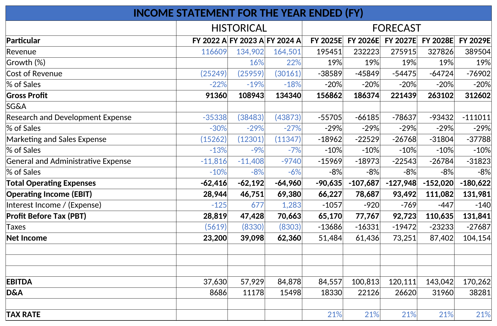
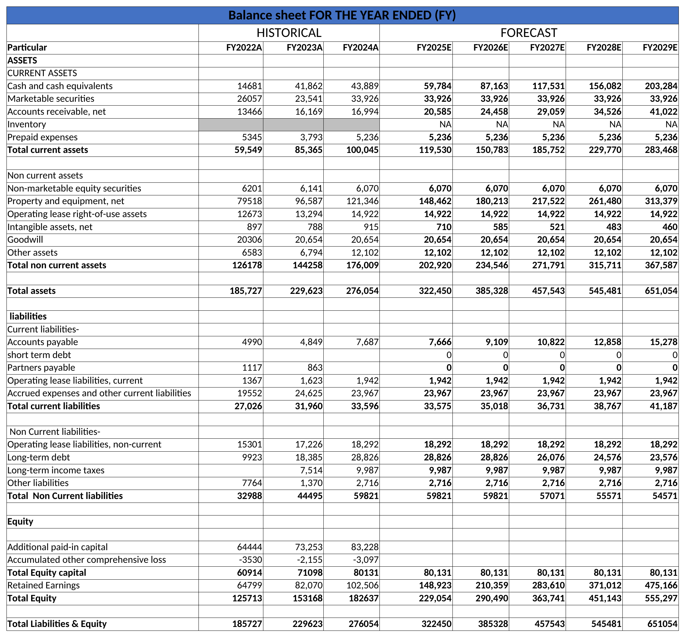
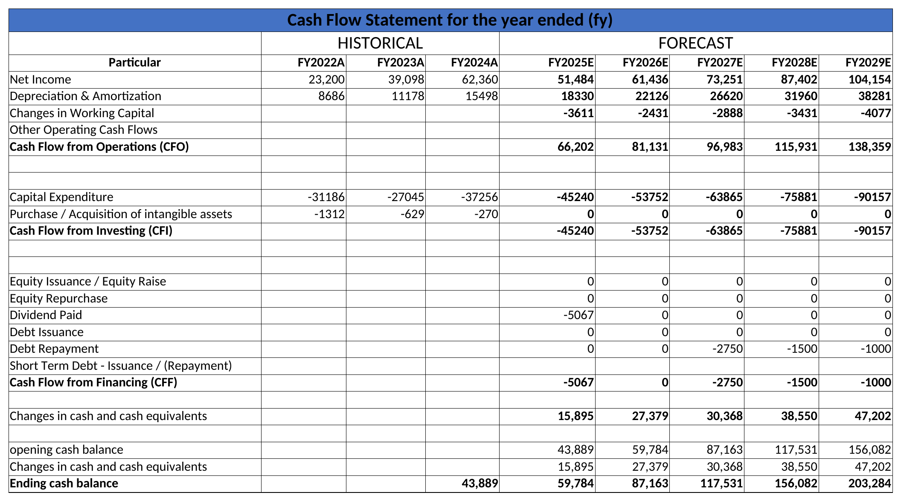
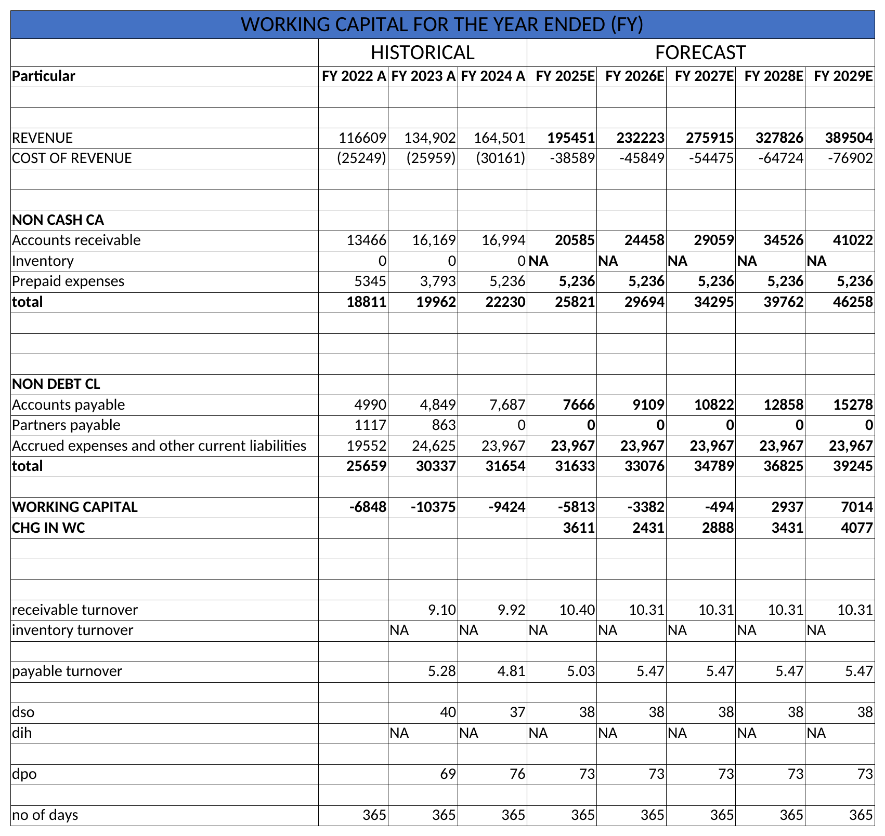

# Meta Platforms – Three-Statement Financial Model

A fully linked Income Statement, Balance Sheet and Cash Flow model of Meta Platforms, built in Excel. It uses historical data for FY2022–FY2024 and forecasts FY2025–FY2029. The balance sheet balances in every year.

## Income Statement

## Balance Sheet

## Cash Flow Statement

## Working Capital Schedule

## Data
- Source: Meta Platforms annual reports (Form 10-K)
- Historical: FY2022 – FY2024 | Forecast: FY2025 – FY2029
- Figures in USD millions

## Model Structure
| Sheet | Description |
|---|---|
| Income Statement | Revenue, costs, EBIT, EBITDA and net income, with growth and % of sales drivers |
| Balance Sheet & Cash Flow | Assets, liabilities and equity, plus the cash flow statement linking ending cash to the balance sheet |
| Debt Schedule | Long-term debt opening/closing, repayments, interest expense and interest income |
| Equity Schedule | Equity capital, retained earnings, net income and dividends |
| D&A Schedule | Capex, PP&E roll-forward, depreciation and amortisation of intangibles |
| Working Capital Schedule | Receivables, payables, DSO, DPO and change in working capital |

## Key Assumptions
- Revenue grows at the FY2024 growth rate (~18.8%) each forecast year
- Cost of revenue, R&D, marketing, G&A and capex are forecast as a % of sales, using the FY2022–FY2024 average
- Depreciation is forecast as a % of opening PP&E (~10.9%)
- Working capital is driven by DSO (~38 days) and DPO (~73 days)
- Tax rate of 21%

## Key Outputs
- Revenue forecast to grow from $164,501M (FY2024) to $389,504M (FY2029)
- Net income forecast to reach $104,154M by FY2029
- Ending cash grows from $43,889M (FY2024) to $203,284M (FY2029)

## Skills Used
Three-statement modelling, financial forecasting, supporting schedules (debt, D&A, equity, working capital), linking the statements, balance sheet checks, Excel

## How to Use
1. Download `Meta_Three_Statement_Model.xlsx`
2. Open it in Microsoft Excel (click **Enable Editing** if prompted)
3. Inputs and assumptions are in blue; change them to see the forecast update
